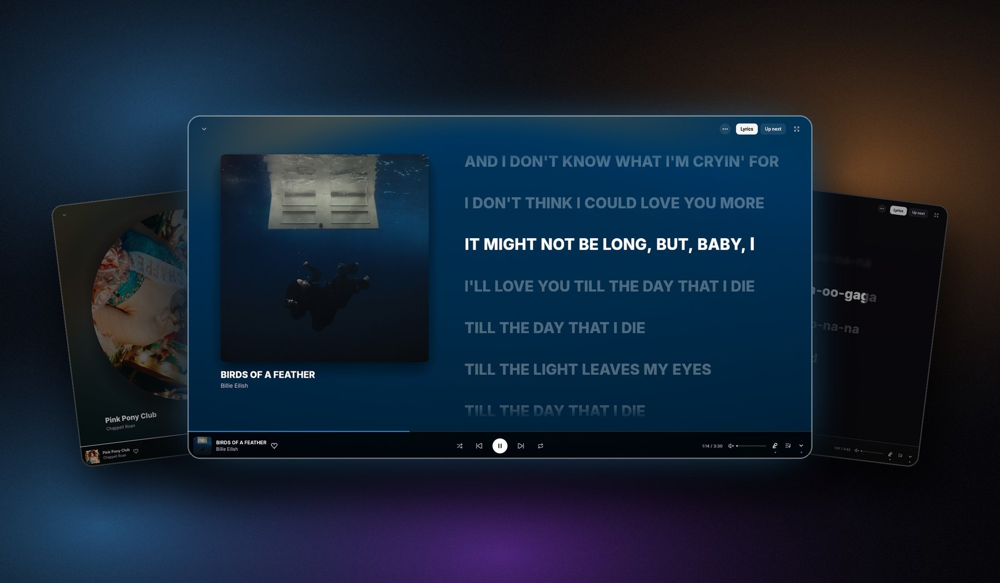
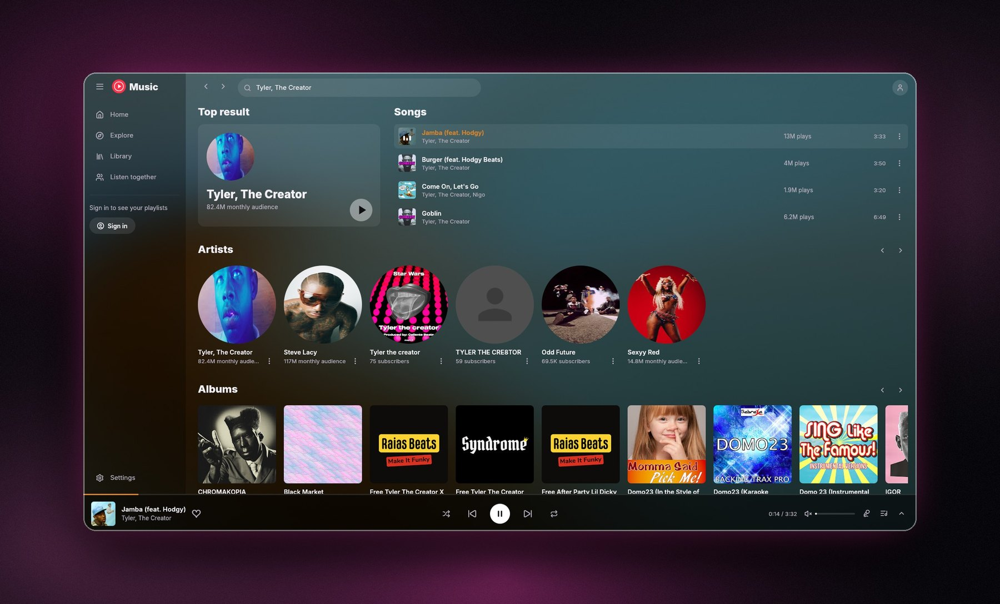

<div align="center">
  
  <h1>ytm-rs</h1>
  <p><strong>YouTube Music in a fast, native desktop app.</strong></p>
  <p>Built in Rust with egui and rodio. No Electron, no browser-based player, and under 100 MB of memory while playing.</p>

  <p>
    <a href="https://github.com/grapedjuice/ytm-rs/releases/latest"></a>
    <a href="https://github.com/grapedjuice/ytm-rs/releases"></a>
    
    <a href="LICENSE"></a>
  </p>

  <p>
    <a href="https://grapedjuice.github.io/ytm-rs/">Website</a> ·
    <a href="https://github.com/grapedjuice/ytm-rs/releases/latest">Download</a> ·
    <a href="#features">Features</a> ·
    <a href="#installation">Installation</a> ·
    <a href="#building-from-source">Build from source</a>
  </p>
</div>

<p align="center">
  
</p>

## Table of contents

- [Features](#features)
- [Screenshots](#screenshots)
- [Installation](#installation)
- [Usage](#usage)
- [Building from source](#building-from-source)
- [Notes](#notes)
- [Contributing](#contributing)
- [License](#license)
- [Acknowledgements](#acknowledgements)

## Features

**Listening**
- **Your music feed:** Listen again, Quick picks, your mixes (My Supermix, Discover Mix and more) and mood filters, refreshed each time you open a page.
- **Explore and search:** new releases, charts, and search across songs, albums, artists and playlists.
- **Your library:** liked songs, saved albums and playlists, history and uploads. Upload your own songs from the Uploads tab or by dropping files on the window.
- **Playback:** queue, song radio, shuffle, repeat and autoplay, with the next track prefetched for instant skips. 256 kbps audio with YouTube Premium, volume normalization, and a choice of output device.
- **Skip non-music parts:** jumps over talking, skits and sponsor breaks in music videos, as marked by SponsorBlock.
- **Downloads:** save any song as a tagged `.m4a` with cover art, at the best quality your account gets, and play it offline.

**Lyrics and looks**
- **Karaoke lyrics:** word-by-word lyrics drawn the way the Better Lyrics extension draws them, from every Better Lyrics source, with automatic fallback, romanization, translations and per-song timing offsets.
- **Animated background:** the album art drifts and pulses with the music behind everything. Go full-screen, or hide the lyrics to see just the artwork.
- **26 themes:** rebuilt from the [Better Lyrics community themes](https://github.com/better-lyrics/themes), such as Apple Music, Spicy, Spinning Record and reCover. Each one restyles the whole app. Use any bundled or installed font.

**Together and across services**
- **Listen together:** start a jam, share the code or link, and up to 16 people hear the same song at the same moment. The host decides whether guests can add songs or control playback.
- **Transfer from Spotify:** bring playlists and Liked Songs over to YouTube Music in the background. ytm-rs asks you when it isn't sure about a match and picks up where it left off if interrupted.
- **Last.fm and Discord:** scrobbling and Rich Presence.

**Desktop**
- System media controls, taskbar thumbnail buttons, close to tray, a collapsible sidebar and screen-reader-accessible controls.
- Automatic updates in the background for both the installed and portable versions, with release notes when an update is ready.

## Screenshots

<table>
  <tr>
    <td width="50%"></td>
    <td width="50%"></td>
  </tr>
  <tr>
    <td align="center"><b>Home</b></td>
    <td align="center"><b>Artist page</b></td>
  </tr>
  <tr>
    <td></td>
    <td></td>
  </tr>
  <tr>
    <td align="center"><b>Spinning Record theme</b></td>
    <td align="center"><b>reCover theme</b></td>
  </tr>
  <tr>
    <td></td>
    <td></td>
  </tr>
  <tr>
    <td align="center"><b>Search</b></td>
    <td align="center"><b>Theme gallery</b></td>
  </tr>
  <tr>
    <td></td>
    <td></td>
  </tr>
  <tr>
    <td align="center"><b>Listen together</b></td>
    <td align="center"><b>Transfer from Spotify</b></td>
  </tr>
</table>

## Installation

Downloads for every platform are on the [latest release](https://github.com/grapedjuice/ytm-rs/releases/latest). Once installed, ytm-rs keeps itself up to date; you can turn this off in **Settings → Updates**.

<details open>
<summary><b>Windows</b></summary>

Download `ytm-rs-setup-<version>.exe` and run it. It installs for the current user without administrator access, and adds a Start menu shortcut and an uninstall entry in Windows Settings.

</details>

<details>
<summary><b>macOS</b></summary>

Download `ytm-rs-setup-<version>-macos-aarch64.dmg` (Apple silicon) or `-macos-x86_64.dmg` (Intel), open it, and drag **ytm-rs** to Applications. Requires macOS 11 or later.

The app isn't notarized, so the first time, right-click it and pick **Open**, or run:

```sh
xattr -dr com.apple.quarantine /Applications/ytm-rs.app
```

Sign-ins are kept in your login Keychain. Jam links don't open the app on macOS yet; type the code on the **Listen together** page instead.

</details>

<details>
<summary><b>Linux</b></summary>

```sh
curl -fsSL https://raw.githubusercontent.com/grapedjuice/ytm-rs/main/linux/install.sh | sh
```

This installs ytm-rs for your user (no root) in `~/.local/lib/ytm-rs`, with a `ytm-rs` command and an app menu entry. If WebKitGTK or other required libraries are missing, it installs them too (that step asks for your password). You can also download `ytm-rs-<version>-linux-x86_64.tar.gz`, extract it and run `./install.sh`.

Sign-ins are kept in your keyring (GNOME Keyring or KWallet). To uninstall, run `~/.local/lib/ytm-rs/install.sh --uninstall`.

</details>

<details>
<summary><b>Portable</b></summary>

Every platform has a portable download that keeps its settings in a `data` folder beside the app and updates itself in place.

| Platform | File | How to run |
| --- | --- | --- |
| Windows | `ytm-rs-portable-<version>.zip` (`-arm64` for ARM) | Unzip anywhere and run `ytm-rs.exe`. It stays portable while `portable.txt` is beside it. |
| macOS | `ytm-rs-portable-<version>-macos-aarch64.zip` or `-macos-x86_64.zip` | Unzip, run `xattr -dr com.apple.quarantine` on the folder, then open `ytm-rs.app`. Without that step macOS runs it from a read-only copy and it uses the normal data location. |
| Linux | `ytm-rs-portable-<version>-linux-x86_64.tar.gz` | Extract anywhere and run `./ytm-rs`. |

Sign-ins are still kept by the system (Credential Manager, Keychain or your keyring), so on another computer you sign in again. Opening jam links needs the installed app; in the portable one, type the code on the **Listen together** page.

</details>

## Usage

| To… | Do this |
| --- | --- |
| **Sign in** | **Settings → Sign in with Google.** Unlocks your feed, library, likes and history. Browsing and search work without it. |
| **Listen together** | Click **Listen together** in the sidebar, start a jam and share the code or link. Songs guests add play next, marked with who added them, up to 5 waiting per guest. |
| **Transfer from Spotify** | **Settings → Import**, then sign in to Spotify to pick a playlist or Liked Songs, or paste a public playlist link without signing in. Matches ytm-rs isn't sure about come to you for review before it creates a private playlist. |
| **Upload music** | **Library → Uploads → Upload music**, or drop MP3, M4A, FLAC, OGG or WMA files on the window. Title, artist, album and cover come from the file's tags. |
| **Download songs** | Open a song's menu and click **Download**. Files go to `Music\ytm-rs`; change this in **Settings → Downloads**. |
| **Scrobble to Last.fm** | **Settings → Connections → Connect** next to Last.fm, then allow ytm-rs in your browser. Songs scrobble after half their length or four minutes. |
| **Change the theme** | **Settings → Theme**, click a card. Turn on **Classic theme** under Appearance for the plain dark look with red accents. |
| **Tune the lyrics** | **Settings → Lyrics** sets the source order, translation language and timing offsets. |

## Building from source

You need the [Rust toolchain](https://rustup.rs/).

```sh
git clone https://github.com/grapedjuice/ytm-rs.git
cd ytm-rs
```

<details open>
<summary><b>Windows</b></summary>

Install the MSVC C++ build tools, then:

```powershell
cargo build --release
```

The app is at `target\release\ytm-rs.exe`.

</details>

<details>
<summary><b>Linux</b> (Debian/Ubuntu package names)</summary>

```sh
sudo apt install build-essential pkg-config libssl-dev libasound2-dev libgtk-3-dev \
  libwebkit2gtk-4.1-dev libxdo-dev libayatana-appindicator3-dev libdbus-1-dev
cargo build --release
```

The app is at `target/release/ytm-rs`.

</details>

<details>
<summary><b>macOS</b></summary>

Install the Xcode command line tools (`xcode-select --install`), then build and wrap it in an app bundle:

```sh
cargo build --release
sh macos/bundle.sh target/release/ytm-rs "$(grep -m1 '^version' Cargo.toml | cut -d'"' -f2)" target/release
```

The app is at `target/release/ytm-rs.app`.

</details>

### Listen together relay

The relay in `server/` is a separate Cloudflare Worker, also in Rust ([workers-rs](https://github.com/cloudflare/workers-rs)). You don't need it to build or run the app, which connects to the hosted relay. To run it locally, start `npx wrangler dev --local` in `server/` and launch the app with `YTM_JAM_SERVER=ws://127.0.0.1:8787`.

## Notes

- The interface and audio playback are native. Google and Spotify sign-in and lyrics verification open temporary system webview windows (WebView2 on Windows).
- Lyrics come from the providers Better Lyrics uses (Better Lyrics, Unison, Musixmatch, LRCLib and others), so availability depends on the track. Translations come from the lyrics when included, otherwise from Unison or Google Translate; machine translations and romanization can be rough.
- The first song after launch can take about 5 seconds to start while the app prepares YouTube's player. After that, songs start instantly.
- Premium-only and age-restricted songs play through your signed-in account. With YouTube Premium they play natively; without it, age-restricted songs fall back to `yt-dlp`, which needs Node.js.
- No audio goes through the Listen together relay. It only passes along what's playing and where; every listener streams the song from YouTube Music themselves.
- Themes are native translations of CSS themes, so some details differ from the originals. Fonts that can't be redistributed (SF Pro, Spotify's) are replaced with the closest open fonts.
- ytm-rs is an unofficial client. Changes to YouTube Music or third-party services can affect playback, sign-in or lyrics.

## Contributing

Found a bug or have an idea? [Open an issue](https://github.com/grapedjuice/ytm-rs/issues). Pull requests are welcome.

## License

ytm-rs is licensed under [GPL-3.0](LICENSE).

## Acknowledgements

- [egui](https://github.com/emilk/egui) for the interface, [rodio](https://github.com/RustAudio/rodio) and Symphonia for audio.
- Browsing, search and your library come straight from YouTube Music's own web API, the one music.youtube.com uses.
- Signed-in stream URLs are decoded with yt-dlp's [EJS](https://github.com/yt-dlp/ejs) solver running in QuickJS.
- Listen together runs on a small relay built with [workers-rs](https://github.com/cloudflare/workers-rs) on Cloudflare Durable Objects.
- The animated background is based on Kawarp from [Better Lyrics](https://github.com/better-lyrics), and the theme presets are adapted from the Better Lyrics theme store, with credit to each theme's creators.
- Fonts: Inter, DM Sans, Google Sans Flex, Figtree and Instrument Sans (SIL OFL 1.1). Icons: Lucide.
