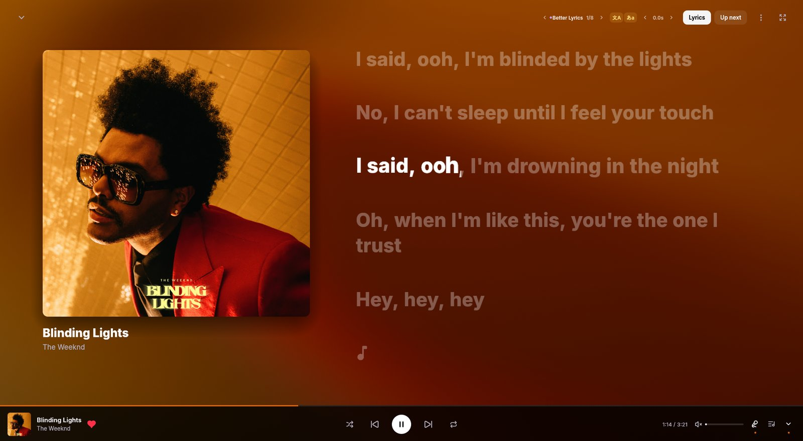
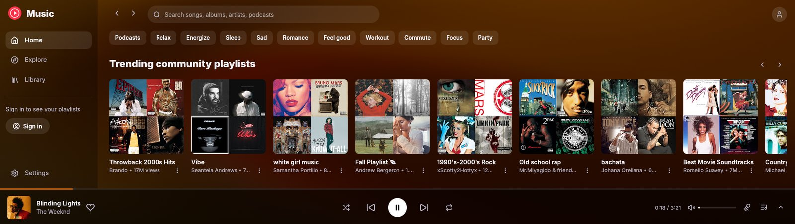
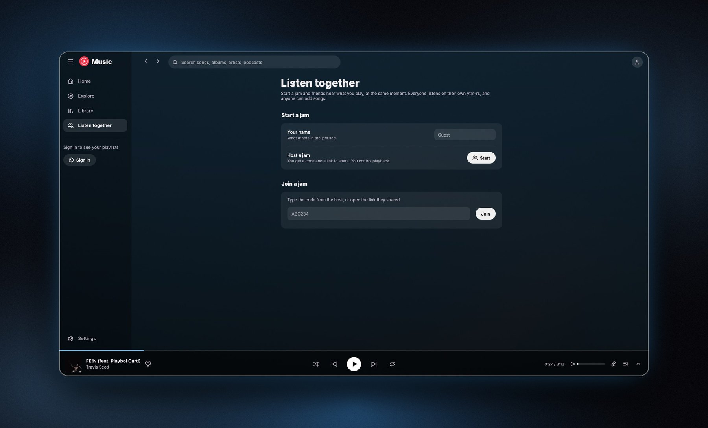
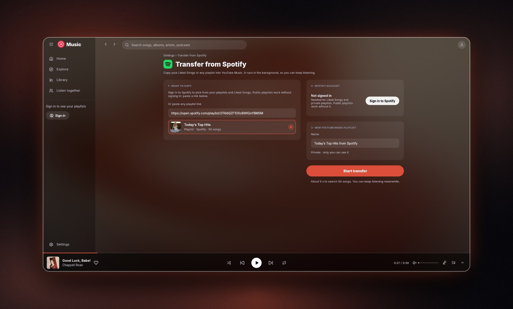
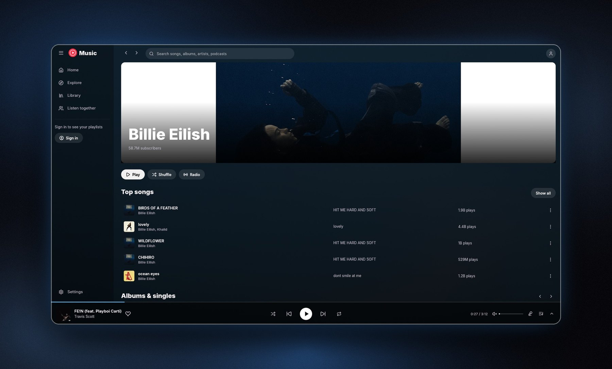
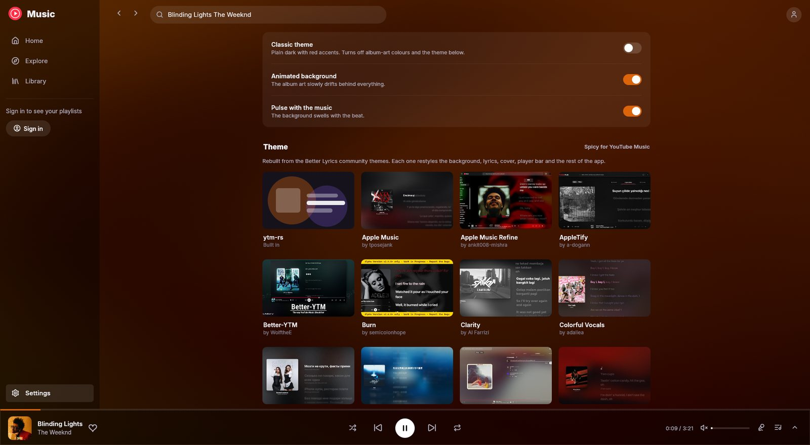
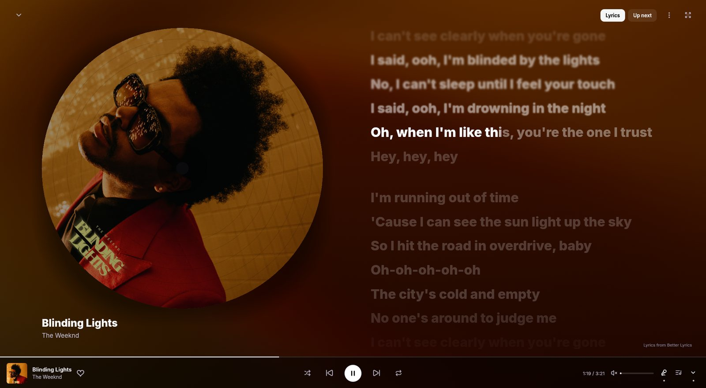
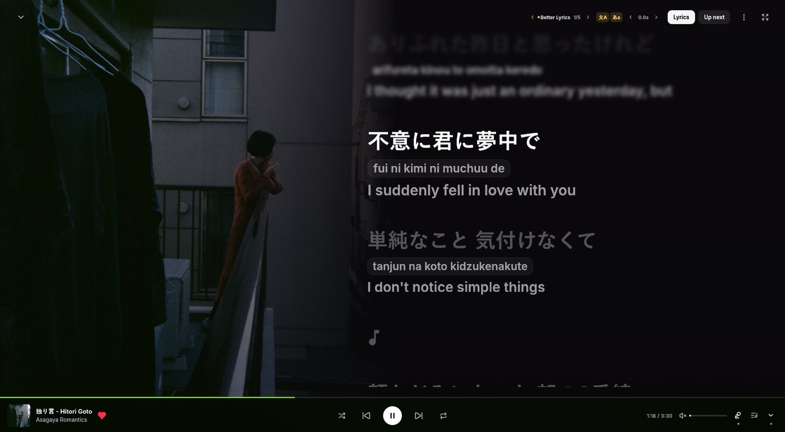

<div align="center">
  
  <h1>ytm-rs</h1>
  <p><strong>YouTube Music in a fast, native desktop app.</strong></p>
  <p>Built with Rust, egui, and rodio. No Electron or browser-based player, and under 100 MB of memory while playing.</p>
  <p>
    <a href="https://grapedjuice.github.io/ytm-rs/">Website</a>
    · <a href="https://github.com/grapedjuice/ytm-rs/releases/latest">Download for Windows</a>
    · <a href="#features">Features</a>
    · <a href="#build-from-source">Build from source</a>
  </p>
</div>

<p align="center">
  
</p>

## Features

| Feature                 | What you can do                                                                                                                                         |
| ----------------------- | ------------------------------------------------------------------------------------------------------------------------------------------------------- |
| **Your music feed**     | Browse your personalized YouTube Music home feed, including Listen again, Quick picks, your mixes (My Supermix, Discover Mix and more), and mood filters. Keep scrolling for more. Pages refresh each time you open them.                |
| **Explore and search**  | Find new releases from US charting artists and artists in your music feed, browse charts, and search for songs, albums, and playlists.              |
| **Your library**        | Access liked songs, saved albums and playlists, listening history and your uploads after signing in. Upload your own songs from the Uploads tab or by dropping audio files on the window. |
| **Playback controls**   | Manage the queue, start radio from a song, and use shuffle, repeat, and autoplay. The next track is prefetched for instant skips. With YouTube Premium, songs play in 256 kbps high quality. Volume normalization turns loud songs down to an even level, the way YouTube Music does. Turn on **Skip non-music parts** to jump over talking, skits and sponsor breaks in music videos, as marked by SponsorBlock. |
| **Lyrics and visuals**  | Follow word-by-word karaoke lyrics rendered the way the Better Lyrics extension draws them, with the same timing, glow and line layout. Lyrics come from every Better Lyrics source; switch sources from the header, and if one has nothing the next takes over automatically. Toggle romanization and translations, nudge the timing per song, and set the source order, translation language and offsets in **Settings → Lyrics**. Click a line to seek, switch to full-screen lyrics, or hide them to see just the artwork over the animated, music-reactive album-art background. |
| **Listen together**     | Start a jam and share its code or link. Friends who open the link land in ytm-rs and hear the same song at the same moment, each streaming it on their own, up to 16 people. As host you choose whether guests can add songs and whether they can pause, skip and seek. |
| **Transfer from Spotify** | Bring your Spotify playlists and Liked Songs over to YouTube Music. ytm-rs finds each song in the background while you keep listening, asks you when it isn't sure about a match, and picks up where it left off if a transfer gets interrupted. Liked Songs can go straight into Liked Music in the same order as on Spotify. |
| **Themes**              | Pick from 26 presets rebuilt from the [Better Lyrics community themes](https://github.com/better-lyrics/themes), such as Apple Music, Spicy, Spinning Record and reCover. Each one restyles the lyrics, background, cover, player bar, fonts and the rest of the app. Prefer another font? Pick a bundled one or any font installed on your PC in **Settings → Appearance**. |
| **Desktop integration** | Use system media controls, previous/play/next buttons on the taskbar thumbnail, Discord Rich Presence, and screen-reader-accessible controls. Close to the tray to keep music playing in the background, and collapse the sidebar to a slim row of icons. |
| **Automatic updates**   | The app (installed or portable) downloads new versions in the background and installs them when you close it, or right away with **Restart to update**. It shows each release's notes when an update is ready and after it installs.              |

## Screenshots

<table>
  <tr>
    <td colspan="2"></td>
  </tr>
  <tr>
    <td colspan="2" align="center">Home</td>
  </tr>
  <tr>
    <td width="50%"></td>
    <td width="50%"></td>
  </tr>
  <tr>
    <td align="center">Listen together</td>
    <td align="center">Transfer from Spotify</td>
  </tr>
  <tr>
    <td></td>
    <td></td>
  </tr>
  <tr>
    <td align="center">Artist page</td>
    <td align="center">Settings and themes</td>
  </tr>
  <tr>
    <td></td>
    <td></td>
  </tr>
  <tr>
    <td align="center">Spinning Record theme</td>
    <td align="center">reCover theme</td>
  </tr>
</table>

## Get started

### Install on Windows

Download the latest `ytm-rs-setup-<version>.exe` from [GitHub Releases](https://github.com/grapedjuice/ytm-rs/releases/latest) and run it. The installer works for the current user without administrator access and adds a Start menu shortcut and an entry in Windows Settings for uninstalling.

Once installed, ytm-rs keeps itself up to date. You can turn this off in **Settings → Updates**.

### Portable

Prefer not to install? Download `ytm-rs-portable-<version>.zip` from the same page, unzip it anywhere and run `ytm-rs.exe`. It keeps its settings in a `data` folder beside the exe (as long as `portable.txt` is there) and updates itself in place. Your sign-in is kept by Windows Credential Manager, so on another PC you sign in again. Opening jam links needs the installed app; in the portable one, type the code on the **Listen together** page.

### Sign in

Open **Settings → Sign in with Google** in the app. Signing in unlocks your music feed, library, likes, and history. You can also browse and search without signing in. Your sign-in is stored encrypted in Windows Credential Manager.

### Listen together

Click **Listen together** in the sidebar to start a jam, then share the code or the link. Friends with ytm-rs installed can open the link, or type the code on the **Listen together** page, to join. Songs guests add play next, marked with who added them, and each guest can have up to 5 waiting at a time.

### Transfer from Spotify

Open **Settings → Import** and sign in to Spotify to pick a playlist or your Liked Songs. Public playlists work without signing in: paste the link. Matches ytm-rs isn't sure about come to you for review before it makes a private playlist on YouTube Music.

### Upload your music

Open **Library → Uploads** and click **Upload music**, or drop MP3, M4A, FLAC, OGG or WMA files anywhere on the window. They go to your YouTube Music library, the same as uploading on music.youtube.com. The title, artist, album and cover come from the file's tags, so tag your files before uploading.

### Pick a theme

Open **Settings → Theme** and click a card. Each card shows the original theme's cover and credits its creators. Turn on **Classic theme** under Appearance for the plain dark look with red accents.

## Build from source

On Windows, install the [Rust toolchain](https://rustup.rs/) and the MSVC C++ build tools, then build the app itself:

```powershell
git clone https://github.com/grapedjuice/ytm-rs.git
cd ytm-rs
cargo build --release
```

The built application is at `target\release\ytm-rs.exe`.

The Listen together relay in `server/` is a separate Cloudflare Worker, also in Rust ([workers-rs](https://github.com/cloudflare/workers-rs)). You don't need it to build or run the app, which connects to the hosted relay. To run it locally, start `npx wrangler dev --local` in `server/` and launch the app with `YTM_JAM_SERVER=ws://127.0.0.1:8787`.

## Notes

- The app interface and audio playback are native. Google and Spotify sign-in and lyrics verification use temporary system webview windows; on Windows, these use WebView2.
- Lyrics come from the providers Better Lyrics uses (Better Lyrics, Unison, Musixmatch, LRCLib and others), so availability depends on the track. Translations come from the lyrics themselves when included, otherwise from Unison or Google Translate; machine translations and romanization can have rough spots.
- The first song after launch can take around 5 seconds to start while the app prepares YouTube's player; after that, songs start instantly.
- Premium-only and age-restricted songs play through your signed-in account. With YouTube Premium they play natively; without it, age-restricted songs fall back to `yt-dlp`, which needs Node.js.
- No audio goes through the Listen together relay. It only passes along what's playing and where, and every listener streams the song from YouTube Music themselves.
- Themes are native translations of CSS themes, not the CSS itself, so some details differ from the originals. Fonts that can't be redistributed (SF Pro, Spotify's) are replaced with the closest open fonts.
- ytm-rs is an unofficial client. Changes to YouTube Music or third-party services can affect playback, sign-in, or lyrics.

## License

[GPL-3.0](LICENSE).

## Built with

[egui](https://github.com/emilk/egui) for the interface, [rodio](https://github.com/RustAudio/rodio) and Symphonia for audio. Browsing, search and your library come straight from YouTube Music's own web API, the one music.youtube.com uses. Signed-in stream URLs are decoded with yt-dlp's [EJS](https://github.com/yt-dlp/ejs) solver running in QuickJS. Listen together runs on a small relay built with [workers-rs](https://github.com/cloudflare/workers-rs) on Cloudflare Durable Objects. The animated background is based on Kawarp from Better Lyrics, and the theme presets are adapted from the Better Lyrics theme store, with credit to each theme's creators. The app also uses Inter, DM Sans, Google Sans Flex, Figtree and Instrument Sans (SIL OFL 1.1) and Lucide icons.

Found a bug or have an idea? [Open an issue](https://github.com/grapedjuice/ytm-rs/issues).
